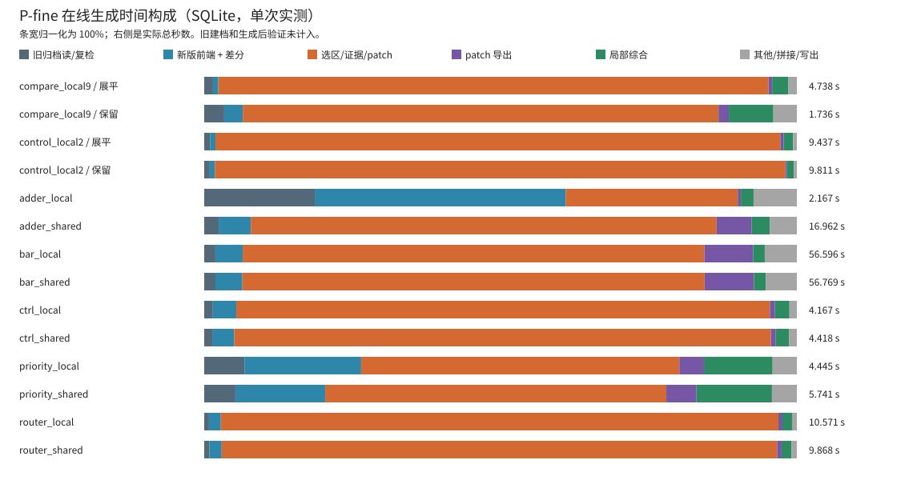

# 多案例耗时归因（2026-11-04）

本轮使用优化后的实现 `f39c05c`，只扩充诊断，不修改综合、选区、证明或替换算法。测试范围沿用此前冻结的 ANUBIS 两个功能修改案例及 EPFL 六个组合电路，没有为了获得收益改换修改位置。

## 测量口径

- 默认 SQLite。ANUBIS `compare_local9`、`control_local2` 各测保留层次/展平，EPFL `ctrl`、`router`、`priority`、`adder`、`bar`、`arbiter` 各测 local/shared，共 16 个案例/模式组合。
- 使用同一固定版本的原版 Yosys、插桩 Yosys 和 ABC，CPU 2 串行执行。源码、工具、实现哈希冻结；没有清空系统缓存。单次样本用于定位瓶颈，不是统计均值或严格的加速比实验。
- 每个可运行组合分别执行一次 F、一次 P-module、一次未加诊断的 P-fine，以及一次带嵌套计时/20 ms Python CPU 采样的 P-fine。P-module 仍是本项目的模块范围选区对照，不是独立模块级增量系统 M。
- **主表全部采用未加诊断的实际生成时间**，截止于完整新网表 JSON/RTLIL/Verilog 写出。旧建档和后验全网表验证不计入；为了确定合法选区而必需的来源/边界证明计入。
- 旧建档在独立进程重新生成，10 个旧电路/层次组合各建档一次，local/shared 共享旧归档。它们均与在线作业分离；旧实验目录保留。在线加载必须命中索引，不允许把重放混进在线计时。
- 每作业 360 秒上限，不设产物大小上限。诊断作业截止后允许清理并输出失败证据；未完成的旧建档只计已消耗时间，不冒充完整用时。
- 关闭 nochange 等价预检查，保留每次生成后的完整等价/交付检查。本轮不重新测面积。

## 在线总时间和实际选区

| 案例 | 新版物理行数 | F s | P-module s | P-fine s | 选区占比 | 选中 / 旧总门数 | 扩区轮数 | 路径 |
|---|---|---|---|---|---|---|---|---|
| compare_local9 / 展平 | 287 | 0.174 | 0.837 | 4.738 | 92.8% | 120 / 236 | 6 | 语句选区 |
| compare_local9 / 保留 | 287 | 0.282 | 0.630 | 1.736 | 80.3% | 110 / 231 | 0 | 语句选区 |
| control_local2 / 展平 | 374 | 0.200 | 2.775 | 9.437 | 95.3% | 130 / 130 | 4 | 模块回退 |
| control_local2 / 保留 | 374 | 0.239 | 0.899 | 9.811 | 96.3% | 69 / 147 | 15 | 语句选区 |
| adder_local | 1205 | 0.533 | 13.104 | 2.167 | 29.0% | 1 / 764 | 0 | 语句选区 |
| adder_shared | 1205 | 0.531 | 13.164 | 16.962 | 78.6% | 764 / 764 | 32 | 模块回退 |
| bar_local | 3739 | 1.405 | 61.822 | 56.596 | 77.9% | 2184 / 2184 | 0 | 语句选区（全部门） |
| bar_shared | 3739 | 1.420 | 62.133 | 56.769 | 78.0% | 2184 / 2184 | 0 | 语句选区（全部门） |
| ctrl_local | 205 | 0.110 | 1.179 | 4.167 | 90.0% | 95 / 97 | 17 | 语句选区 |
| ctrl_shared | 205 | 0.107 | 1.187 | 4.418 | 90.6% | 95 / 97 | 14 | 语句选区 |
| priority_local | 1101 | 1.086 | 8.981 | 4.445 | 53.7% | 131 / 384 | 0 | 语句选区 |
| priority_shared | 1101 | 0.902 | 8.884 | 5.741 | 57.6% | 253 / 384 | 0 | 语句选区 |
| router_local | 348 | 0.166 | 1.983 | 10.571 | 94.1% | 172 / 172 | 32 | 模块回退 |
| router_shared | 348 | 0.185 | 1.963 | 9.868 | 93.7% | 172 / 172 | 32 | 模块回退 |
| arbiter_local | 13189 | 9.855 | N | N | N | N | N | N |
| arbiter_shared | 13189 | 9.863 | N | N | N | N | N | N |

N：缺少可用旧归档，在线增量未启动；不是零耗时，也不是来源证据拒绝。行数按入口及递归 include 文件的物理行数去重求和，包含头文件；不是仅有 3 行的 ANUBIS 包装文件，也不是展开后语句数。

## 在线阶段拆分

以下全部是**未加诊断**运行的内置阶段计时，单位秒。每行各项相加等于上表 P-fine 总时间（显示四舍五入可能产生毫秒差）。新版前端/proc 含原生前端解析展开、原版 `read_rtlil; proc; check; write_json`、表示读取及范围检查，不能称为纯 `proc` 耗时。旧归档项含开始加载和交给替换器时的哈希复检。

| 案例 | 旧归档读/复检 | 新版前端/proc | IR 差分 | 选区/证据/patch | patch 写出 | 契约复检 | 局部 synth | 拼接/写网表 | 其他 |
|---|---|---|---|---|---|---|---|---|---|
| compare_local9 / 展平 | 0.070 | 0.038 | 0.005 | 4.398 | 0.029 | 0.009 | 0.130 | 0.025 | 0.033 |
| compare_local9 / 保留 | 0.058 | 0.049 | 0.006 | 1.393 | 0.030 | 0.010 | 0.130 | 0.025 | 0.034 |
| control_local2 / 展平 | 0.093 | 0.074 | 0.012 | 8.995 | 0.055 | 0.016 | 0.149 | 0.019 | 0.024 |
| control_local2 / 保留 | 0.091 | 0.074 | 0.012 | 9.446 | 0.026 | 0.008 | 0.114 | 0.017 | 0.024 |
| adder_local | 0.404 | 0.459 | 0.459 | 0.629 | 0.011 | 0.001 | 0.046 | 0.053 | 0.105 |
| adder_shared | 0.414 | 0.459 | 0.460 | 13.332 | 1.005 | 0.484 | 0.521 | 0.077 | 0.210 |
| bar_local | 1.065 | 1.371 | 1.240 | 44.082 | 4.662 | 2.426 | 1.112 | 0.180 | 0.457 |
| bar_shared | 1.073 | 1.369 | 1.214 | 44.276 | 4.728 | 2.320 | 1.134 | 0.177 | 0.478 |
| ctrl_local | 0.061 | 0.092 | 0.073 | 3.752 | 0.036 | 0.011 | 0.101 | 0.017 | 0.024 |
| ctrl_shared | 0.060 | 0.089 | 0.075 | 4.000 | 0.036 | 0.011 | 0.098 | 0.016 | 0.032 |
| priority_local | 0.302 | 0.442 | 0.434 | 2.387 | 0.185 | 0.077 | 0.515 | 0.035 | 0.070 |
| priority_shared | 0.302 | 0.440 | 0.430 | 3.305 | 0.292 | 0.126 | 0.731 | 0.039 | 0.076 |
| router_local | 0.085 | 0.113 | 0.098 | 9.946 | 0.072 | 0.028 | 0.171 | 0.023 | 0.036 |
| router_shared | 0.085 | 0.114 | 0.092 | 9.249 | 0.074 | 0.034 | 0.163 | 0.022 | 0.035 |

## 选区内部慢在哪里

下表取自**另外一次带诊断的运行**，各项互斥，不重复累加父调用和子调用。它用于定位原因，不能直接与上一张表逐毫秒相减。

“契约组装”包含契约自身执行、来源证据收集、父契约解码/复制、哈希与序列化等；SQL 邻接读取、边解码发生在各调用内部，不能把某个整列直接解释为纯 SQLite 时间。“源码功能证明”包括归档源码降级、切割函数构造、miter/SAT，不只是求解器时间。“复制功能检查”检查已选门及边界复制后的函数，不替代 RTL 来源证明。

| 案例 | 诊断选区总计 | 来源查询/路径 | 契约组装/序列化 | 源码功能证明 | 边界/扩区 | IR依赖/patch | 复制功能检查 | 其他 |
|---|---|---|---|---|---|---|---|---|
| compare_local9 / 展平 | 4.797 | 2.283 | 1.821 | 0.165 | 0.193 | 0.033 | 0.275 | 0.028 |
| compare_local9 / 保留 | 1.547 | 0.812 | 0.511 | 0.000 | 0.089 | 0.028 | 0.082 | 0.025 |
| control_local2 / 展平 | 9.712 | 5.362 | 3.594 | 0.315 | 0.141 | 0.192 | 0.084 | 0.025 |
| control_local2 / 保留 | 9.998 | 4.654 | 4.417 | 0.243 | 0.323 | 0.157 | 0.162 | 0.043 |
| adder_local | 1.056 | 0.008 | 0.297 | 0.000 | 0.010 | 0.282 | 0.000 | 0.459 |
| adder_shared | 13.852 | 5.729 | 5.265 | 0.833 | 0.622 | 0.707 | 0.243 | 0.453 |
| bar_local | 45.334 | 15.750 | 13.878 | 12.445 | 0.108 | 0.953 | 0.292 | 1.907 |
| bar_shared | 46.593 | 16.301 | 14.236 | 12.666 | 0.198 | 0.961 | 0.323 | 1.907 |
| ctrl_local | 4.073 | 1.326 | 2.075 | 0.217 | 0.149 | 0.134 | 0.064 | 0.106 |
| ctrl_shared | 4.366 | 1.483 | 2.217 | 0.197 | 0.167 | 0.127 | 0.069 | 0.106 |
| priority_local | 2.887 | 0.948 | 0.690 | 0.384 | 0.011 | 0.292 | 0.075 | 0.486 |
| priority_shared | 3.943 | 1.507 | 1.028 | 0.473 | 0.016 | 0.338 | 0.049 | 0.532 |
| router_local | 10.255 | 6.095 | 2.736 | 0.191 | 0.348 | 0.232 | 0.557 | 0.096 |
| router_shared | 9.885 | 6.062 | 2.586 | 0.205 | 0.330 | 0.243 | 0.364 | 0.093 |

生成前的调用次数也单独统计；不包括生成后在独立上下文重做的验证。带诊断/不带诊断的差值同时含观测开销和单次运行波动。

| 案例 | 未加诊断 s | 带诊断 s | 契约构建次数 | cell 路径检查次数 | 源码 SAT 次数 | 最终计划 MiB |
|---|---|---|---|---|---|---|
| compare_local9 / 展平 | 4.738 | 5.135 | 32 | 2163 | 1 | 0.49 |
| compare_local9 / 保留 | 1.736 | 1.895 | 9 | 820 | 0 | 0.57 |
| control_local2 / 展平 | 9.437 | 10.157 | 33 | 1555 | 2 | 0.88 |
| control_local2 / 保留 | 9.811 | 10.363 | 85 | 2143 | 1 | 0.42 |
| adder_local | 2.167 | 2.620 | 1 | 1 | 0 | 0.02 |
| adder_shared | 16.962 | 17.473 | 3 | 855 | 1 | 24.57 |
| bar_local | 56.596 | 57.953 | 2 | 2184 | 1 | 139.40 |
| bar_shared | 56.769 | 59.399 | 2 | 2184 | 1 | 139.40 |
| ctrl_local | 4.167 | 4.504 | 57 | 1321 | 1 | 0.61 |
| ctrl_shared | 4.418 | 4.778 | 63 | 1445 | 1 | 0.61 |
| priority_local | 4.445 | 5.003 | 2 | 131 | 1 | 4.97 |
| priority_shared | 5.741 | 6.503 | 2 | 253 | 1 | 8.13 |
| router_local | 10.571 | 10.900 | 48 | 1850 | 1 | 1.70 |
| router_shared | 9.868 | 10.521 | 46 | 1989 | 1 | 1.70 |

## 实测结论与优化优先级

**本轮 14 个可运行组合中，13 个的选区/证据/patch 阶段超过在线时间的一半。所有 P-fine 仍慢于 F；局部综合只占约 1.2%–12.7%。** 因此问题主要不是第一次插桩综合被混进在线时间，也不是局部 `synth` 普遍太慢。

1. **优先减少来源路径的重复查询与解码。** ANUBIS、ctrl、router、priority、adder_shared、bar 都有这一开销。bar 的来源查询/路径约 15.75–16.30 秒，router 约 6.06–6.10 秒。CPU 栈反复落在 `index_store.Edges.decode/adjacent`、`graph_index.has_path/walk`；它们在读取索引后仍会反复构造 Python 边对象。下一步可在同一归档/对象版本内复用已验证可达性结果，批量读取邻接关系；固定的旧对象来源路径检查也可考虑离线建档时建立证书。必须保留事件顺序、来源集合和归档绑定，不能拿普通无序可达性替换现有证据规则。
2. **降低契约构建和在线计划的重复数据。** ctrl 两例构建 57/63 次契约，control 保留层次构建 85 次；bar 虽然只构建 2 次，但每份最终计划约 139.4 MiB，组装/序列化本身约 13.88–14.24 秒。其 `region` 和 `outputs` 是大字段，旧证据引用 `provenance` 并非主要体积来源。应优先共享逐门来源集合、逐输出证据和不可变父契约，减少深复制、重复哈希和反序列化；字段审计显示，即使改用紧凑 JSON，整份计划仍约 48.39 MiB，其中仅逐门 `origin_ids` 数组的值就约 32.94 MiB；仅删除 JSON 空白不能消除这些结构性重复。
3. **把输入切点扩区也纳入成本控制，并区分无复用的路径。** control 保留层次的 15 轮扩区中，10 轮是 `source_input_cut_unproven`；ctrl local/shared 分别有 8/7 轮这类扩区。上一轮主要优化了输出闭包预览，这些输入缺口仍触发中间契约构建。router local/shared 均到 32 轮后模块回退，最后增量生成约 10.57/9.87 秒，P-module 对照只需约 1.98/1.96 秒。bar 两例则从初始种子就已选中全部 2,184 门，扩区次数为 0，需改进来源选区精度或采用明确标注的成本后备策略。若后备到 F，必须统计之前的尝试加 F 总时间，并标为全量后备，不能称为细粒度复用成功。
4. **针对 bar 单独优化源码功能证明。** 两例旧源码证明约 12.45/12.67 秒，其中 SAT 子进程约 11.26/11.45 秒；其余案例此类 SAT 作业不超过约 0.36 秒。可以研究按输出/共享锥分区和复用相同切点证明，但全部外部输出、有定义性和独立输入条件不能省略。SAT 子进程时间仍包含读取与准备，不是纯求解器 CPU 时间。
5. **小目标优先削减固定前端和校验成本。** adder_local 只换 1/764 门：新版前端 0.459 秒、IR 差分 0.459 秒、旧归档加载加复检 0.404 秒，合计约占 2.167 秒总生成时间的 61%；局部综合仅 0.046 秒。可把旧 IR 规范化、依赖图等固定信息放到离线索引，并在同一次请求内安全复用已校验内容。较大的共同查询瓶颈降低后，这类固定成本仍决定小修改的时间下限。

`priority_local/shared` 的 P-fine 为 4.45/5.74 秒，低于同框架 P-module 的 8.98/8.88 秒，说明细粒度选区确实能减少部分工作；但 F 仅约 1.09/0.90 秒，仍未形成相对全量的时间收益。不能仅凭门复用比例推断加速。

上述顺序对应不同成本来源；不建议一次同时重写选区、存储与证明器。先验证“路径与解码复用”对所有案例的收益，再处理重复计划数据和输入扩区；bar 的证明成本另列专项。

## arbiter：独立旧建档诊断

本次仍未在 360 秒内建成有效索引，两个 arbiter 修改均未启动在线 P-module/P-fine。原版 F 分别为 9.855/9.863 秒。失败记录没有被剔除。

| 离线阶段 | 本次诊断耗时 | 状态 |
|---|---:|---|
| 插桩综合与原始记录写出 | 63.832 s | 完成 |
| 原生记录重放（含首次候选细化） | 24.455 s | 完成 |
| ABC 证据检查整体 | 79.788 s | 完成 |
| 其中：ABC 内部证据读取 | 62.987 s | 完成，已包含在上一行 |
| 独立原版综合对照 | 9.854 s | 通过 |
| 等价检查 | 2.002 s | 通过 |
| 索引构建 | 已耗 170.703 s | 未完成，不能解释成完整构建用时 |

含嵌套行，不可整列相加。截止后失败报告和清理使作业墙钟为 360.990 秒。最大单进程峰值 RSS 约 8.22 GiB，并非同时刻进程树内存总和。索引阶段 CPU 栈主要落在 `sqlite_index.Sink.add` 的逐行写入与 `index_store.document` 的 JSON 编码；本轮没有精确拆分它们各自的墙钟比例。

这是**首次旧建档瓶颈**，必须解决才能支持 arbiter 在线查询，但不能把这些秒数加到其他案例的 P-fine 在线时间里。下一步可单独量化批量插入、延后建物理索引和重复文档编码各自的成本；本轮未改动存储或校验规则。

## 复现与保留范围

这些数值是 2026-11-04 的历史归因结果，不代表当前修复后的速度。图表和结论保留，旧原始作业目录已清理；若原顶层存在汇总报告，可在 `runs/retained-summaries/` 查阅。最新大例子与捕获优化见 [hyp](hyp.md)。

当前可用 `python3 -m experiments compare` 重新生成对比作业，再用 `python3 -m experiments.profile JOB.json --profile-out NEW_DIRECTORY --timeout 360` 单独诊断。JOB 使用 `experiments.experiment_worker` 的结构，输出目录必须为新目录。诊断计时有附加开销，应与未加诊断的正式生成时间分开报告。
